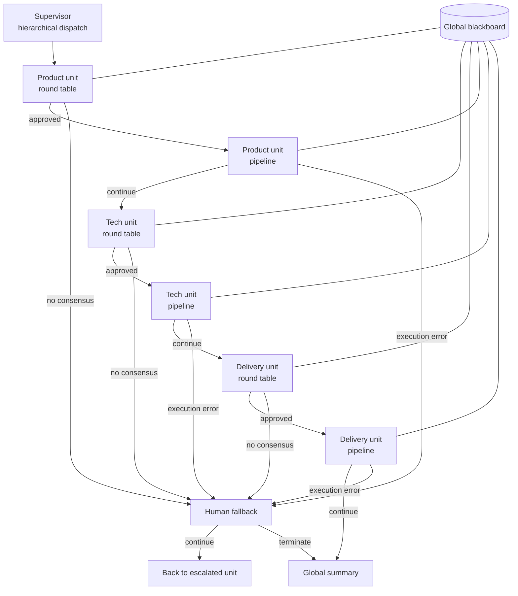

# Hybrid Composition Architecture

A supervisor hands out work, round tables produce decisions, pipelines deliver, and one blackboard carries state through the whole run. Built with LangGraph 1.x subgraphs, following the article "Multi-Agent Architecture Explained: Hybrid Composition Architecture (Mainstream Industrial Practice)".

The offline mode needs no API key and runs the whole flow. Set an OpenAI-compatible endpoint and the agents switch to LLM-driven mode automatically.

## Architecture



| Layer | Responsibility | Implementation |
| --- | --- | --- |
| Top | Take the goal, split it into business units with a fixed plan, collect results | `supervisor` node |
| Middle | Run an expert round table inside each unit: product, architecture, security, and testing speak in order, a host decides | `build_roundtable_subgraph` |
| Bottom | Execute fixed steps in order after approval, producing standardized deliverables | `build_pipeline_subgraph` |
| Global | Every subgraph reads and writes one shared state for plans, reviews, risks, and artifacts | `HybridState.blackboard` |

If a round table exceeds the round limit or a pipeline step fails, the flow escalates to a human fallback node. The human can resume the escalated unit or terminate the run.

Nodes and edges are wired when the graph is built; runtime only picks branches. That is different from an adaptive architecture, which reworks its topology while running.

## Dependencies


- Python 3.10 or newer.
- `langgraph>=1.0.0`; tested with 1.2.24.
- Online mode uses the standard-library `urllib` client, no extra SDK.

## Project Structure

```text
混合组合架构/
├── hybrid_architecture.py        # State, agent brains, round-table subgraph, pipeline subgraph, top graph, CLI
├── test_hybrid_architecture.py   # Tests: full delivery, multi-round review, escalation, graph export
├── requirements.txt              # Dependencies
├── readme.md                     # English documentation (main)
└── readme_CN.md                  # Chinese documentation
```

The main module reads top to bottom: constants, state, agent brains, round-table and pipeline subgraphs, top-level graph, CLI. Business units and pipeline steps live in `V_单元配置`; expert personas live in `V_专家配置`. Change those two to move the system to another domain.

## Usage

Install dependencies:

```powershell
python -m pip install -r requirements.txt
```

Run the default example:

```powershell
python hybrid_architecture.py
```

Custom task, escalation demo, and graph export:

```powershell
python hybrid_architecture.py --task "Design a flash-sale feature for a shopping app"
python hybrid_architecture.py --task "Design a flash-sale feature for a shopping app" --fail-unit 技术单元
python hybrid_architecture.py --mermaid
python hybrid_architecture.py --json
```

To use an LLM, set the environment variables and pass `--online`:

```powershell
$env:OPENAI_API_KEY = "your-key"
$env:OPENAI_BASE_URL = "https://api.chatanywhere.tech/v1"
$env:OPENAI_MODEL = "gpt-4o-mini"
python hybrid_architecture.py --online
```

Without `--online`, the system still uses the LLM when a key exists; pass `--offline` to force the rule-based brains.

Options:

| Option | Meaning |
| --- | --- |
| `--task` | Overall task; defaults to the flash-sale example |
| `--offline` | Force rule-based offline brains |
| `--online` | Force LLM brains; requires a key |
| `--fail-unit` | Keep one business unit rejecting review, to exercise escalation |
| `--mermaid` | Print the LangGraph Mermaid diagram only |
| `--json` | Print the final state for debugging the blackboard |

Run tests:

```powershell
python -m unittest -v test_hybrid_architecture.py
```

Coverage: normal delivery, blackboard sharing, multi-round review, escalation to human fallback, graph structure, and JSON parsing of model replies.

## Contributing

1. Open an issue with the scenario and reproduction steps, including the task text and CLI flags.
2. Fork, create a focused branch, and keep each change scoped to one problem.
3. To add a business unit, start from `V_单元配置` and add a matching test case.
4. Run `python -m unittest -v test_hybrid_architecture.py` before submitting.
5. In the pull request, state what changed, why, and how you verified it.

## Contact

Ailan Anjuxi (谙弆悕博士)

📫 Email: anjuxi.ME@outlook.com

📞 SIP: sip:anjuxi@sip.linphone.org

> © 2026 谙弆悕博士（Ailan Anjuxi），All rights reserved.
