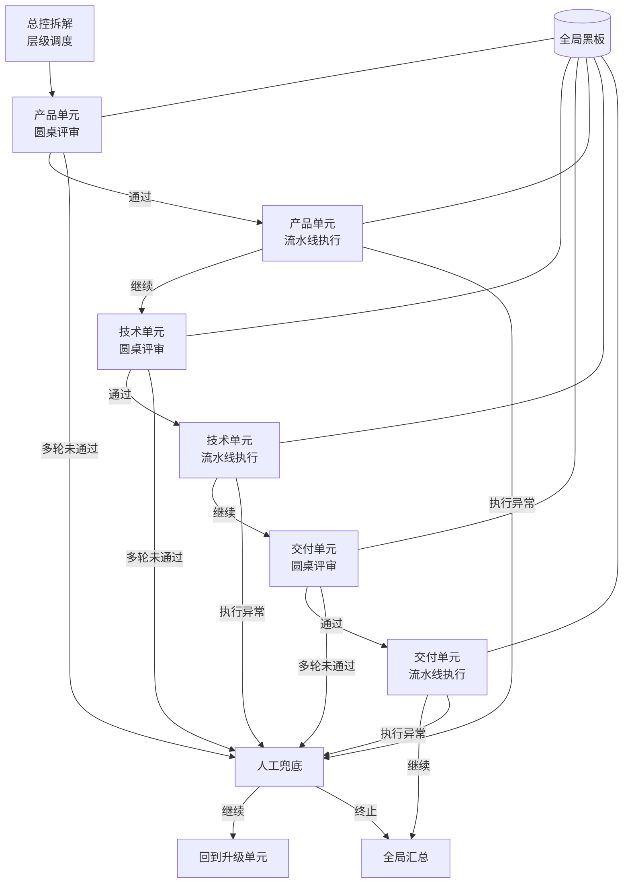

# 混合组合架构（Hybrid Composition Architecture）

层级总控派活，圆桌评审出结论，流水线负责交付，黑板存全程状态。项目按《多智能体架构详解：混合组合架构（工业落地主流）》里的思路实现，用 LangGraph 1.x 的子图能力搭起来。

离线模式不需要任何 API 密钥，能直接跑完整流程；配置 OpenAI 兼容接口后自动切换成大模型驱动。

## 架构分层



| 层级 | 职责 | 实现位置 |
| --- | --- | --- |
| 顶层 | 承接目标，按固定计划把任务拆给业务单元，逐级收集结果 | `supervisor` 节点 |
| 中层 | 单元内部拉专家圆桌，产品、架构、安全、测试轮流发言，主持人定稿 | `build_roundtable_subgraph` |
| 底层 | 评审通过后按固定步骤串行执行，产出标准化交付物 | `build_pipeline_subgraph` |
| 全局 | 所有子图读写同一份状态，存放计划、评审结论、风险、产物 | `HybridState.blackboard` |

评审超过轮次上限或者流水线执行异常时，统一进入人工兜底节点。人工可以选择回到原单元继续，也可以直接终止流程。

节点和边在建图时就写死，运行时只做分支判断，不会自动改拓扑。这一点和运行时动态换拓扑的自适应架构不同。

## 依赖说明


- Python 3.10 及以上。
- `langgraph>=1.0.0`，开发环境实测 1.2.24。
- 在线模式只用标准库 `urllib` 调 OpenAI 兼容接口，不额外引入 SDK。

## 项目结构

```text
混合组合架构/
├── hybrid_architecture.py        # 主程序：状态、Agent 大脑、圆桌子图、流水线子图、顶层图、CLI
├── test_hybrid_architecture.py   # 单元测试：完整交付、多轮讨论、升级人工、图结构导出
├── requirements.txt              # 依赖清单
├── readme.md                     # 英文说明（主文档）
└── readme_CN.md                  # 中文说明
```

主程序从上到下依次是常量、状态定义、Agent 大脑、圆桌与流水线子图、顶层图和 CLI。业务单元和流水线步骤集中在 `V_单元配置`，专家阵容在 `V_专家配置`，改这两处就能换成别的业务场景。

## 使用说明

安装依赖：

```powershell
python -m pip install -r requirements.txt
```

跑默认示例：

```powershell
python hybrid_architecture.py
```

指定任务、演示升级链路、导出结构图：

```powershell
python hybrid_architecture.py --task "为电商 App 设计一个限时秒杀功能"
python hybrid_architecture.py --task "为电商 App 设计一个限时秒杀功能" --fail-unit 技术单元
python hybrid_architecture.py --mermaid
python hybrid_architecture.py --json
```

接大模型时设置环境变量，然后加 `--online`：

```powershell
$env:OPENAI_API_KEY = "你的密钥"
$env:OPENAI_BASE_URL = "https://api.chatanywhere.tech/v1"
$env:OPENAI_MODEL = "gpt-4o-mini"
python hybrid_architecture.py --online
```

不开 `--online` 时，只要环境里有密钥也会用在线模式；要强制离线就加 `--offline`。

参数说明：

| 参数 | 作用 |
| --- | --- |
| `--task` | 整体交付任务，默认是秒杀功能示例 |
| `--offline` | 强制使用离线规则大脑 |
| `--online` | 强制使用在线大模型，需要密钥 |
| `--fail-unit` | 指定持续评审不通过的业务单元，用来演练升级人工 |
| `--mermaid` | 只打印 LangGraph 导出的流程图 |
| `--json` | 结束时打印完整状态，便于排查黑板内容 |

跑测试：

```powershell
python -m unittest -v test_hybrid_architecture.py
```

测试覆盖正常交付、黑板共享、多轮评审、升级人工、图结构和 JSON 解析。

## 贡献指南

1. 在 Issues 里说明场景和复现步骤，尽量附上任务文本和运行参数。
2. Fork 后新建分支，改动尽量聚焦单一问题。
3. 新增业务单元时，优先改 `V_单元配置`，同时补一条测试用例。
4. 提交前跑一遍 `python -m unittest -v test_hybrid_architecture.py`。
5. PR 描述里写清楚改了什么、为什么改、怎么验证。

## 联系作者

谙弆悕博士（Ailan Anjuxi）

📫 邮箱：anjuxi.ME@outlook.com

📞 SIP 电话：sip:anjuxi@sip.linphone.org

> © 2026 谙弆悕博士（Ailan Anjuxi），All rights reserved.
